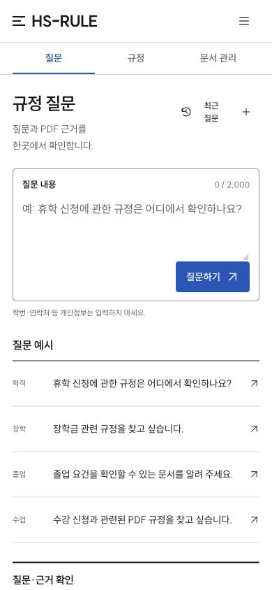
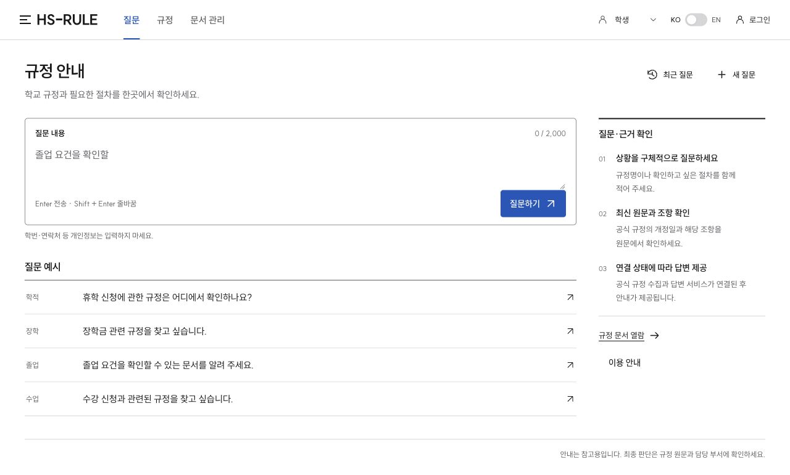
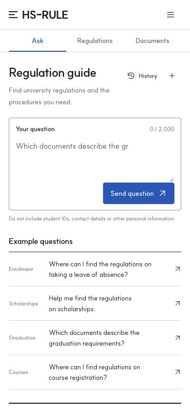

# HS-RULE UI 배포

사용자가 확정한 주소는 `https://hs.officeworkkit.com`이다. 이전 `hs.officeworkkt.com`과 `hs.officework.kit` 표기는 이 주소로 정정한다.

| 항목 | 구성 |
|---|---|
| 공개 범위 | 새 한국어·영어 UI |
| 호스팅 | Cloudflare Workers Static Assets, `hs-rule` |
| 기본 주소 | `https://hs-rule.soil0119.workers.dev` |
| 사용자 도메인 | `https://hs.officeworkkit.com` |
| 백엔드 | 이번 배포에 포함하지 않음. FastAPI·규정·RAG 연결은 후속 이슈 |

## 배포 폴더 만들기

저장소 루트에서 Python 표준 라이브러리만으로 실행한다.

```sh
python3 scripts/build_ui_site.py
```

`.build/hs-rule-ui/`에 HTML·CSS·JS·아이콘·SUIT 폰트와 OFL 라이선스, 경로/헤더 설정을 만든다. 런타임 파일을 명시적으로 선택하므로 원본 ZIP, `.env`, 업로드 문서, 데이터·서버 코드·QA 파일은 공개 폴더에 들어가지 않는다. 파일별 해시 목록은 공개 폴더 밖의 `.build/hs-rule-ui-manifest.json`에 기록한다.

Cloudflare 계정의 Workers & Pages에서 `Upload your static files`를 선택하고 **`.build/hs-rule-ui/` 폴더만** 올린다. 기존 서비스는 `hs-rule`의 `New deployment`에서 갱신한다. 도메인과 DNS는 코드 갱신 때 다시 만들 필요가 없다.

`_redirects`는 `/login-page`를 로그인 HTML에 연결한다. `/upload`는 Cloudflare의 기본 HTML 경로 처리로 제공한다. `/upload /upload.html 200` 규칙을 추가하면 기본 정규화와 겹쳐 자기 자신으로 307 이동을 반복하므로 추가하지 않는다. `_headers`는 콘텐츠 형식 추측 방지와 referrer 정책을 설정한다. 폰트는 자체 호스팅한다.

## 확인 범위

루트·로그인·문서 화면, CSS·JS·아이콘·폰트의 응답과 실제 브라우저 화면을 확인한다. 질문·규정 목록·로그인·문서 처리·AI 분석은 실제 백엔드가 연결된 뒤 별도로 검증한다. 정적 사이트 배포가 해당 API의 동작을 뜻하지 않는다.

배포 후에는 `python3 scripts/check_ui_site.py`로 HTTPS와 화면 경로, 배포 파일의 바이트 일치 및 비공개 파일의 미노출을 확인한다. Python과 시스템 `curl`을 사용하며 TLS 검증을 유지한다.

후속 백엔드 연결 시 `PUBLIC_ORIGIN`과 허용 호스트를 `https://hs.officeworkkit.com` 기준으로 설정한다. [운영 #8](https://github.com/soil0119/HS-RULE/issues/8), [도메인 #31](https://github.com/soil0119/HS-RULE/issues/31), [프론트 연결 #13](https://github.com/soil0119/HS-RULE/issues/13)에서 남은 범위를 추적한다.

## 실제 배포 기록 — 2026-11-23

Cloudflare 대시보드의 정적 파일 업로드로 배포했고, Custom Domain을 `hs.officeworkkit.com`의 Production에 연결했다. 최초 경로 수정 배포 버전은 `55beccfa`로 시작하며 Ready·100% 상태를 확인했다.

| 검증 | 실제 결과 |
|---|---|
| DNS | Cloudflare 권한 서버가 `hs.officeworkkit.com`에 A 레코드 2개를 반환 |
| HTTPS·경로·자산 | `python3 scripts/check_ui_site.py`의 18개 검사 통과. 3개 화면 경로 및 공개 파일의 바이트가 빌드 결과와 일치 |
| 파일 경계 | `.env`, 서버 소스, 원본 ZIP, `_headers`, `_redirects`는 HTTP 404 |
| 브라우저 | 실제 도메인의 홈·로그인·문서 화면과 한영 전환/선택 유지 확인 |
| 모바일·폰트 | 390×844에서 가로 넘침 없음(`scrollWidth=390`), 로컬 폰트 `loaded` 확인 |

최초 배포에서 `/upload`의 중복 rewrite가 자기 자신으로 307 이동을 반복하는 것을 확인해 해당 규칙을 제거하고 재배포했다. 위 검사는 수정 후 결과다. Cloudflare 연결 앱은 재인증이 필요해, 이미 로그인된 대시보드에서 배포했다.



## 공개 화면 피드백 반영 — 2026-11-23

후속 배포 버전은 `9c1660f7`로 시작하며 Ready·100% 상태를 확인했다. [#36](https://github.com/soil0119/HS-RULE/issues/36)의 브라우저 피드백과 예시 타이핑 요청을 반영했다.

| 변경·검증 | 확인 결과 |
|---|---|
| 안내·불필요 문구 | 제목을 ‘규정 안내’로 변경, 학교명 푸터와 예시 보조 문구 삭제. PDF 중심 안내를 공식 규정 원문·개정일·조항 기준으로 수정 |
| 언어 스위치 | 상단/모바일 메뉴의 한영 스위치, Space 키 전환, 화면 간 선택 유지 확인 |
| 예시 애니메이션 | 공개 사이트의 placeholder가 길어졌다가 짧아짐을 관찰. 포커스 시 중지, 직접 입력값 유지 확인 |
| 회귀 검사 | `node design/hs-rule-ui/qa/verify.cjs` 588개 모의 DOM/API 검사 통과. 동작 줄이기의 정적 예시도 이 검사에서 확인 |
| HTTPS·자산 | 수정 후 `python3 scripts/check_ui_site.py` 18개 검사 재통과. 실제 공개 응답과 빌드 바이트 일치 |
| 반응형·폰트 | 한국어 데스크톱, 영어 390×844 화면 확인. 모바일 `scrollWidth=390`, 로컬 폰트 `loaded`, History 줄바꿈 없음 |

공식 크롤러·카탈로그·조문 출처 및 RAG 연결은 후속 담당 이슈에 남아 있다. 위 결과는 UI 동작과 정적 배포에 대한 검증이다.




