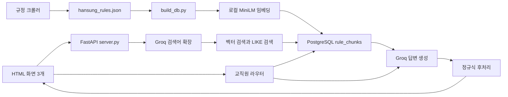

# HS-RULE 프로젝트 진단 및 고도화안

진단일: 2026-11-23 (Asia/Seoul)
기준: `main`의 `a84e0d6533715d8446ed661104ca3e386a8a592c` — 초기 구성 PR #1 머지 후.
범위: UI, API 계약·권한, 규정 수집·색인·검색·생성, 파일 처리, 실행·검증 구성.

## 결론

현재 앱은 FastAPI와 PostgreSQL/pgvector, 로컬 MiniLM 임베딩, Groq를 사용하는 수동 구성 RAG다. LangChain은 설치되어 있지 않다. 가장 먼저 복구할 대상은 규정 원문이다. 제공된 JSON 315건은 실제 조항 대신 메뉴·개정 이력 화면을 담고 있다. 이 데이터를 색인하면 유효한 규정 근거를 검색할 수 없다.

고도화 순서는 **원문·메타데이터 복구 → 안전한 색인 → 근거 검증을 포함한 LangChain 검색·생성 → API·권한 정비 → UI 연결 → 실제 질의 평가**로 제안한다. UI 디자인은 이 작업과 독립적으로 진행할 수 있다.

## 확정한 구현 방향

진단 후 사용자 요청으로 규정 입력을 **제공 PDF**로 확정했다. 크롤러 재수집을 구현 범위에서 제외하고 문서·페이지 근거를 보존하는 PDF 수집·색인을 구현한다. 서비스 주소는 `https://hs.officeworkkt.com`, UI는 PC·모바일 전체 메뉴다. UI·LangChain RAG·핵심 API 실제 구현과 잦은 기능별 커밋·분리 PR을 승인받았다. 아래 수집기 진단은 기준 커밋의 과거 상태에 대한 근거다.

Groq 공식 종료 문서에 따르면 기존 Llama 4 Scout는 2026-07-17 일반 무료·개발 계정에서 종료됐고 Enterprise 계약 예외가 있다. 새 구현은 Groq 공급자를 유지하면서 모델을 환경변수로 선택하며 기본값은 현재 지원되는 `openai/gpt-oss-120b`로 한다. [공식 모델 종료 안내](https://console.groq.com/docs/deprecations)

## 확인한 현재 구성

| 구간 | 실제 구성 | 제약 |
|---|---|---|
| 화면 | `index.html`, `login.html`, `upload.html`에 CSS·JS 내장 | 같은 UI 구성과 렌더링 로직을 여러 파일에서 관리 |
| 서버 | `server.py`에 설정·인증·파일 처리·검색·목록 결합 | 모듈 import가 모델 로딩과 필수 설정 검사까지 수행 |
| 데이터 | 원본 JSON과 DB 업로드 청크를 목록에서 합침 | 문서·개정·공개 범위·수집 상태를 관리하는 모델 부재 |
| 생성 | Groq 호출과 한국어 출력 형식을 문자열·정규식으로 처리 | 인용 검증·구조화된 오류·토큰 사용량 관측 부재 |
| 실행 | Python 3.11, 로컬 DB용 Compose | 앱 컨테이너·배포·운영 관측 구성은 없음 |
| 테스트 | 크롤러 쿠키 설정 단위 테스트 3개 | 검색 품질·인증·업로드·API 통합 회귀 검사 부재 |

## 규정 데이터 실측

| 항목 | 확인 결과 |
|---|---|
| JSON 레코드 | 315건, SEQ는 315개 모두 고유 |
| 제목 | 315건 모두 `규정정보 상세` |
| 조항 헤더 | `제\s*\d+\s*조`가 있는 본문 0건 |
| 본문 길이 | 최소 122자, 중앙값 155자, 최대 264자 |
| 화면 껍데기 표시 | `규정관리시스템`, `규정정보 상세`, `개정내역`, `규정 목차 여닫이 버튼`, `글자 축소`가 각각 315건에 존재 |
| 규정 코드·첨부 메타데이터 | `rule_code`, `attachments` 필드가 모두 없음 |
| 현재 청커 결과 | 315건 모두 `full` 청크. 실제 조항 단위 청크 0개 |

공식 사이트의 동일한 SEQ=20, 개정 ID=1623을 제한적으로 확인했다. 상세 화면은 메뉴와 개정 이력을, 본문 화면은 실제 조항을 제공했다. 본문은 쿠키 없이 HTTP 200으로 조회됐고 텍스트 27,415자와 `#lawcontent > div.JO`, `div.article` 구조를 확인했다. 이 확인은 한 규정에 한정하며 315건 전체의 현재 접근·완전성을 입증하지 않는다. 과거 수집 시 껍데기가 저장된 정확한 경위는 로그가 없어 단정할 수 없다.

- [공식 상세 화면](https://rule.hansung.ac.kr/lmxsrv/law/lawFullView.do?SEQ=20&SEQ_HISTORY=1623)
- [공식 조항 본문](https://rule.hansung.ac.kr/lmxsrv/law/lawFullContent.do?SEQ=20&SEQ_HISTORY=1623)

## 우선순위별 진단

P1은 신뢰할 수 있는 검색 또는 서비스 공개 전에 해결할 항목, P2는 안정적인 운영과 확장을 위해 필요한 항목이다. 정적 위험 경로 확인을 실제 악용 발생으로 해석하지 않는다.

| 우선순위 | 문제·영향 | 근거와 조치 |
|---|---|---|
| P1 | 규정 본문이 없는 데이터를 성공으로 수집·색인 | [`hansung_rules.json`](https://github.com/soil0119/HS-RULE/blob/a84e0d6533715d8446ed661104ca3e386a8a592c/hansung_rules.json#L20), [`update_crawler.py`](https://github.com/soil0119/HS-RULE/blob/a84e0d6533715d8446ed661104ca3e386a8a592c/update_crawler.py#L283). HTTP 상태와 글자 수 대신 본문 DOM·조항·부록 구조를 검증하고 메뉴 응답을 반려한다. |
| P1 | 기존 SEQ를 건너뛰어 잘못된 스냅샷이 유지됨 | [`update_crawler.py`](https://github.com/soil0119/HS-RULE/blob/a84e0d6533715d8446ed661104ca3e386a8a592c/update_crawler.py#L337). 검증 실패 문서 재수집과 명시적인 갱신 모드를 제공한다. |
| P1 | 조항 정규식이 본문 내 교차 참조까지 분리하고 긴 예외를 절단 | [`build_db.py`](https://github.com/soil0119/HS-RULE/blob/a84e0d6533715d8446ed661104ca3e386a8a592c/build_db.py#L23). 공식 본문 한 건에서 정규식 150회 중 58회가 줄 중간에서 일치했다. 139개 청크의 고유 ID는 98개여서 삽입 시 41개가 소실될 수 있었다. DOM 조항 경계·고유 ID·길이 제한에 맞는 하위 청크를 사용한다. |
| P1 | DB 재구축이 업로드 자료를 삭제하고 부분 실패로 정상 종료 | [`build_db.py`](https://github.com/soil0119/HS-RULE/blob/a84e0d6533715d8446ed661104ca3e386a8a592c/build_db.py#L55), [삽입 루프](https://github.com/soil0119/HS-RULE/blob/a84e0d6533715d8446ed661104ca3e386a8a592c/build_db.py#L74). 기존 테이블을 먼저 삭제하지 않고 검증한 새 색인을 원자적으로 교체한다. |
| P1 | 검색 점수가 실제 관련성과 다른 고정값이고 인용을 검증하지 않음 | [`server.py`](https://github.com/soil0119/HS-RULE/blob/a84e0d6533715d8446ed661104ca3e386a8a592c/server.py#L522), [응답 조립](https://github.com/soil0119/HS-RULE/blob/a84e0d6533715d8446ed661104ca3e386a8a592c/server.py#L579), [`index.html`](https://github.com/soil0119/HS-RULE/blob/a84e0d6533715d8446ed661104ca3e386a8a592c/index.html#L559). 키워드 0.85·0.70과 코사인 점수를 직접 비교한다. 순위 융합·독립 근거 기준·실제 검색 후보 ID 검증이 필요하다. |
| P1 | 기본 관리자 계정과 로그인 제한 부재 | [`server.py`](https://github.com/soil0119/HS-RULE/blob/a84e0d6533715d8446ed661104ca3e386a8a592c/server.py#L28), [로그인](https://github.com/soil0119/HS-RULE/blob/a84e0d6533715d8446ed661104ca3e386a8a592c/server.py#L205). 알려진 기본값을 없애고 명시적 초기 설정, 로그인 시도 제한, 일관된 서명키와 만료 정책을 둔다. |
| P1 | 원본 파일명이 저장·삭제 경로를 결정 | [`server.py`](https://github.com/soil0119/HS-RULE/blob/a84e0d6533715d8446ed661104ca3e386a8a592c/server.py#L418), [삭제](https://github.com/soil0119/HS-RULE/blob/a84e0d6533715d8446ed661104ca3e386a8a592c/server.py#L458). 인증된 관리자 입력이어도 경로 경계 검사가 필요하다. 서버 발급 문서 ID로 저장하고 파일명은 표시용 메타데이터로 보관한다. |
| P1 | 교직원 충돌 분석이 무인증이며 업로드 청크도 공개 질의에서 검색 | [`routers/teacher.py`](https://github.com/soil0119/HS-RULE/blob/a84e0d6533715d8446ed661104ca3e386a8a592c/routers/teacher.py#L130), [`server.py`](https://github.com/soil0119/HS-RULE/blob/a84e0d6533715d8446ed661104ca3e386a8a592c/server.py#L510). 역할과 문서 공개 범위를 검색 전에 적용하고 외부 모델 전송 범위를 명시한다. |
| P1 | 업로드명·모델 출력·출처가 동적 HTML에 들어감 | [`index.html`](https://github.com/soil0119/HS-RULE/blob/a84e0d6533715d8446ed661104ca3e386a8a592c/index.html#L483), [충돌 결과](https://github.com/soil0119/HS-RULE/blob/a84e0d6533715d8446ed661104ca3e386a8a592c/index.html#L653), [`upload.html`](https://github.com/soil0119/HS-RULE/blob/a84e0d6533715d8446ed661104ca3e386a8a592c/upload.html#L338). 정적 XSS 위험 경로를 확인했다. 텍스트 노드 렌더링, 허용 URL 검증, 인라인 이벤트 제거가 필요하다. 현재 관리자 JWT는 `localStorage`에 있다. |
| P2 | 입력 내부 타입·길이·파일 크기를 제한하지 않음 | [`server.py`](https://github.com/soil0119/HS-RULE/blob/a84e0d6533715d8446ed661104ca3e386a8a592c/server.py#L145), [파일 읽기](https://github.com/soil0119/HS-RULE/blob/a84e0d6533715d8446ed661104ca3e386a8a592c/server.py#L233). `messages[].content` 누락, 손상 DOCX, 잘못된 출처 점수가 500이 된다. 타입·개수·바이트 상한과 일관된 오류 응답이 필요하다. |
| P2 | 후속 질문을 독립된 질문처럼 검색하고 정상 이력을 잘못 잘라냄 | [`server.py`](https://github.com/soil0119/HS-RULE/blob/a84e0d6533715d8446ed661104ca3e386a8a592c/server.py#L553). 현재 질문이 이력에 중복된다는 UI 전제를 없애고 이력 계약을 고정한다. 후속 질문에 한해 검색어를 이력으로 보완한다. |
| P2 | 충돌 분석의 실패와 문맥 누락이 정상 결과로 보일 수 있음 | [`routers/teacher.py`](https://github.com/soil0119/HS-RULE/blob/a84e0d6533715d8446ed661104ca3e386a8a592c/routers/teacher.py#L140), [파싱](https://github.com/soil0119/HS-RULE/blob/a84e0d6533715d8446ed661104ca3e386a8a592c/routers/teacher.py#L184). 참고 조항 400자·문서 3,000자 절단과 JSON 파싱 실패를 별도 상태로 드러낸다. |
| P2 | 장애·부팅·비동기 작업 처리 경계가 약함 | [`server.py`](https://github.com/soil0119/HS-RULE/blob/a84e0d6533715d8446ed661104ca3e386a8a592c/server.py#L39), [헬스 체크](https://github.com/soil0119/HS-RULE/blob/a84e0d6533715d8446ed661104ca3e386a8a592c/server.py#L191), [업로드](https://github.com/soil0119/HS-RULE/blob/a84e0d6533715d8446ed661104ca3e386a8a592c/server.py#L318). import 시 외부 의존성 초기화, 장애 시 health 200, async 함수 내부 동기 작업, 매번 새 DB 연결을 정비한다. |
| P2 | 중복·동시 업로드가 문서 단위로 제어되지 않음 | [`server.py`](https://github.com/soil0119/HS-RULE/blob/a84e0d6533715d8446ed661104ca3e386a8a592c/server.py#L326), [식별자](https://github.com/soil0119/HS-RULE/blob/a84e0d6533715d8446ed661104ca3e386a8a592c/server.py#L387). DB의 문서 고유 제약·트랜잭션과 서버 발급 ID를 사용한다. |
| P2 | 동 출처 UI에 전역 CORS가 설정되고 오류 원문이 노출됨 | [`server.py`](https://github.com/soil0119/HS-RULE/blob/a84e0d6533715d8446ed661104ca3e386a8a592c/server.py#L55), [오류 응답](https://github.com/soil0119/HS-RULE/blob/a84e0d6533715d8446ed661104ca3e386a8a592c/server.py#L546). 실제 출처에 맞는 정책과 사용자용 오류·서버 로그를 구분한다. |

규정 코드 역시 단독 고유 키로 쓸 수 없다. 현재 본문에서 복구되는 코드 중 `3-1-84`, `3-1-86`은 서로 다른 SEQ 두 건씩에서 관찰된다. 문서·개정·조항 ID와 청크 순번을 식별자로 사용한다. 현재 JSON의 SEQ나 현재 `full` 청크 ID가 이미 충돌한다는 의미는 아니다.

원본 ZIP은 사용자 요청으로 비공개 저장소에 보관되어 있고 원래 세션 쿠키를 포함한다. 유효성은 확인하지 않았으며 진단 중 사용하거나 다른 서비스로 전송하지 않았다. 저장소 공개를 계획한다면 이 보관 파일과 Git 이력의 취급, 해당 세션 폐기를 먼저 결정해야 한다.

## 현재 API 계약 전체

FastAPI 자동 문서 경로를 제외한 앱 경로는 14개다. 같은 응답을 제공하는 정적 경로와 내보내기 경로는 아래 표에서 묶었다.

| 메서드·경로 | 현재 인증 | 요청·정상 응답 | 확인한 오류·제약 |
|---|---|---|---|
| `GET /`, `/login-page`, `/upload`, `/HSU_logo.png` | 공개 | HTML·PNG | `/upload`의 로그인 이동은 브라우저 동작이며 서버 권한 검사가 아니다. |
| `GET /health` | 공개 | `ok`, `chunks` | DB 장애에도 HTTP 200과 오류 원문. |
| `POST /login` | 공개 | `username`, `password` → `success`, `token` | 실패 401, 누락 422. 12시간 JWT, 로그인 시도 제한 없음. |
| `POST /query` | 공개 | `question`, `messages` → `answer`, `sources`, `found`, `dept`, `dept_phone`, `followups` | 빈 질문 400. 이력 내부 형식 오류·외부 실패 500. 업로드 문서 공개 범위 필터 없음. |
| `GET /rules` | 공개 | `chapters`, `total` | JSON·DB 실패를 무시하고 가용 데이터만 200으로 응답. 현재 이름 315개가 동일. |
| `POST /upload-regulation` | Bearer | multipart `file` → `success`, `filename`, `chunks` | 인증 401, 추출 400, 중복 409, DB·임베딩 500. 크기·형식 경계와 원자성 부족. |
| `GET /uploaded-rules` | Bearer | `rules[]`: `filename`, `chunks`, `tag` | 인증 401, DB 500. 페이지 구분 없음. |
| `DELETE /uploaded-rules/{filename:path}` | Bearer | `success`, `filename`, `deleted_chunks` | 미등록 404. 파일명 기반 식별·경로 처리. |
| `POST /conflict/` | 공개 | multipart `file` → `summary`, `conflicts[]`, `recommendations`, `filename` | 손상 DOCX 500. JSON 파싱 실패는 200과 빈 충돌 목록. |
| `POST /export/pdf`, `/export/docx` | 공개 | `content`, 선택 `title`, `sources`, `question` → 파일 | 출처 내부 타입 불일치 500. 한글 PDF는 실제 폰트·렌더링 검증 필요. |

## 제안하는 LangChain RAG

선택안은 기존 PostgreSQL/pgvector·Groq·MiniLM을 유지하는 2단계 RAG다. `langchain-core`와 `langchain-groq`를 중심으로 검색·프롬프트·응답 검증을 구성한다. 기존 SQL 스키마를 유지하며 검색 함수를 Retriever로 노출할 수 있으므로 LangChain 전용 테이블로 이관하는 작업은 필수가 아니다.

| 후보 | 장점 | 비용·선택 |
|---|---|---|
| 기존 SQL 검색 + LangChain 검색·생성 조합 | 기존 저장소·DB 재사용, 근거와 오류를 한 경로에서 검증 | **권장안**. 원문 복구와 품질 평가를 함께 수행한다. |
| LangChain 전용 PGVectorStore로 전환 | 표준 저장소 인터페이스 사용 | 테이블·문서 모델 이관이 추가된다. 필요한 검색 기능을 확인한 뒤 결정한다. |
| 에이전트형 다중 검색·도구 호출 | 여러 데이터 소스를 오가며 탐색 가능 | 호출 비용·응답 지연·권한 검증 범위가 커진다. 현재 규정 단일 자료군에는 우선순위가 낮다. |

권장 경로는 다음과 같다.

1. **수집 검증:** `#lawcontent`의 실제 조항 노드를 읽고 메뉴 응답을 실패로 기록한다. 조항이 없는 부록·표는 확인된 본문 구조로 별도 처리한다. 수집일·SEQ·개정 ID·원문 URL·첨부 처리 상태를 보존한다.
2. **색인:** 문서·개정·조항·청크를 구분한다. 원문 전문을 보존하고 조항 안에서 임베딩 모델의 실제 토큰 한도에 맞춰 하위 청크를 만든다. 원본 수집과 관리자 업로드의 갱신 범위를 분리하고 트랜잭션으로 교체한다.
3. **검색:** 입력을 정규화하고 후속 질문은 이력으로 독립 질의로 보완한다. 제목·규정 코드·정규화 조항·키워드 검색과 벡터 검색을 독립 실행한 뒤 RRF 등 순위 기반 결합을 적용한다. 검색 전에 공개 범위 필터를 적용한다.
4. **생성:** `ChatPromptTemplate`·Retriever·`ChatGroq`를 조합한다. 답변·사용 근거 ID·관련 질문·근거 부족 상태를 Pydantic으로 검증한다. 문서 내용은 데이터로 다루고 그 안의 명령을 시스템 지시로 승격하지 않는다.
5. **근거 검증:** 반환한 근거 ID가 실제 검색 후보에 포함되는지 서버가 확인한다. 검증 실패·근거 부족·모델 파싱 실패를 정상 답변이나 ‘충돌 없음’으로 표시하지 않는다. 검색 순위 점수를 답변 확률이나 퍼센트 신뢰도로 표시하지 않는다.
6. **평가:** 정답 조항·개정·첨부가 표시된 한국어 질의셋으로 Recall@k·MRR·인용 일치·무근거 응답·지연을 비교한다. 합성 테스트와 실제 규정 평가 결과를 구분한다.

MiniLM 모델 카드의 기본 최대 입력 길이는 128토큰이다. 한 조항 전체를 무조건 하나의 임베딩 입력으로 넣으면 뒷부분이 검색 표현에서 빠질 수 있으므로 토큰 기반 분할이 필요하다. Groq의 구조화 출력은 선택한 모델과 방식에 따라 지원 범위가 다르다. 기존 Scout는 일반 개발 계정에서 종료됐으므로 지원 모델을 선택하고 구조화 출력·Pydantic·인용 ID 검증을 실제 계정에서 확인한다. 모델명과 타임아웃·재시도 횟수는 환경 설정으로 관리한다.

색인 규모와 실제 지연을 확인한 뒤 HNSW·키워드 색인을 추가한다. 현재 자료량에 대한 성능 측정은 수행하지 않았다.

## UI 개선 범위

사용자 선택: **PC·모바일 동시 지원 / 전체 메뉴와 주요 화면 / 서비스 수준의 UI**. OpenDesign Cloud에서 이 범위의 디자인을 생성한다.

| 화면 | 변경 목표 | 연결할 상태 |
|---|---|---|
| 공통 탐색 | 큰 상단 영역을 줄이고 질문·목록·문서 관리와 대화 내역을 일관된 메뉴로 연결 | PC 사이드바, 모바일 메뉴, 키보드 이동·포커스 |
| 규정 질문 | 질문 입력과 답변, 근거 확인 영역을 함께 읽기 쉽게 구성 | 대기·검색 중·근거 없음·오류·답변, 안전한 동적 렌더링 |
| 규정 목록 | 규정명·부서·편별 탐색과 원문 이동을 제공 | 실제 데이터 수, 검색 결과 없음, 부분 데이터·조회 오류 |
| 문서 관리 | 로그인과 업로드·목록·삭제·충돌 분석 흐름을 연결 | 권한 없음, 파일 검증, 진행률, 중복, 분석 실패 |
| 로그인 | 같은 시각 언어로 계정 입력과 실패 안내 구성 | 입력 오류·인증 실패·진행 중 |

학생·교직원 토글은 질문 예시·화면 개인화다. 서버 권한 부여 수단으로 사용하지 않는다. 현재 데이터 상태에서 실제 규정 답변이나 데이터 준비 완료 상태를 꾸며내지 않는다. 디자인 예시는 실제 검색 성공과 구분한다.

## API 고도화에서 확정할 계약

| 구간 | 권장 계약 |
|---|---|
| 요청·응답 | Pydantic 내부 모델, 질문·이력·출처 개수 및 길이 상한, 문서화된 오류 코드와 요청 ID |
| 준비 상태 | liveness와 readiness 분리, DB·색인·모델 준비 실패는 readiness 503 |
| 인증 | 명시적 관리자 초기 설정, 로그인 시도 제한, 세션 만료·로그아웃 정책. 쿠키 세션을 선택하면 HttpOnly·Secure·SameSite와 CSRF 대책을 함께 구현 |
| 문서 | 서버 발급 ID, 원래 파일명·콘텐츠 해시·출처·개정·공개 범위·색인 상태를 메타데이터로 관리 |
| 업로드 | 스트림 바이트 상한, 허용 형식·추출 실패 구분, 경로 경계, 트랜잭션과 실패 복구 |
| 질의·분석 | 조회 권한을 먼저 적용하고 근거 부족·외부 모델 장애·응답 파싱 실패를 구분 |
| 운영 | 제한된 동시 작업, DB 연결 관리, 외부 호출 타임아웃·재시도, 비밀값을 제외한 오류·지연·토큰 사용량 관측 |

운영 대상 사용자, 업로드 자료의 공개 범위, 외부 모델 전송 정책에 따라 최종 인증·문서 계약이 달라진다. 제안 기본값은 공식 공개 규정은 공개 검색, 관리자 업로드는 비공개다. API 버전 경로 전환은 UI·호출자 변경과 묶어 결정하며 진단 단계에서 일괄 변경하지 않는다.

## 검증 결과와 제한

| 검증 | 결과·범위 |
|---|---|
| 기존 단위 테스트 | `python -m unittest discover -s tests -v` 3개 통과. 쿠키 설정만 검증한다. |
| 소스·의존성 | Python 구문 확인과 설치된 직접 의존성 핀 비교 통과. |
| API 계약 | 합성 값, 외부 의존성 스텁, 실제 소켓 차단을 사용한 오프라인 ASGI·OpenAPI 검사. 인증·입력 오류·장애 상태를 확인했다. 실제 통합 E2E가 아니다. |
| 수집·청크 | 전체 JSON 통계, 합성 조항·장문·ID, 공식 공개 본문 한 건으로 검증. 전체 규정 재수집은 미실행. |
| 검색·생성 | 합성 후보와 모델 출력으로 점수 결합·이력·인용·정규식 문제 재현. 실제 Groq·DB·임베딩 검색 품질은 미검증. |
| 실행 설정 | 로컬 `.env` 없음. 실제 API 키·운영 DB·세션 쿠키를 사용하지 않았다. |

## 구현 순서와 완료 조건

| 단계 | 산출물 | 완료 조건 |
|---|---|---|
| 1. 데이터 기반 | 본문 DOM 파서, 수집 품질 보고서, 갱신 모드, 검증된 규정 스냅샷 | 메뉴 응답 반려, 실제 조항·개정 메타데이터 확인, 누락·첨부 실패 명시 |
| 2. 저장·색인 | 문서 ID·개정·청크·공개 범위, 안전한 재색인 | 교차 참조로 오분할하지 않고 전문 보존, 중복 ID 없음, 실패 시 기존 자료 유지 |
| 3. LangChain | Retriever·검색 결합·구조화 답변·인용 검증 | 잘못된 근거와 파싱 실패 차단, 후속 질의·근거 없음 회귀 통과 |
| 4. API·UI 연결 | 입력 검증·권한·파일 경계·상태 계약과 생성 UI | 공개/관리자 경계와 PC·모바일 주요 흐름 검증 |
| 5. 실제 평가 | 정답 질의셋·검색/인용/지연 결과·실행 문서 | 실제 DB·임베딩·Groq 연결에서 검증한 범위와 미검증 항목 명시 |

이 문서는 진단과 제안이며 위 고도화 항목이 이미 구현·배포됐다는 의미가 아니다.

## 공식 기술 근거

- [LangChain 검색: 기존 지식 저장소 재사용과 RAG](https://docs.langchain.com/oss/python/deepagents/retrieval)
- [ChatGroq 통합](https://docs.langchain.com/oss/python/integrations/chat/groq)
- [Groq 구조화 출력 지원](https://console.groq.com/docs/structured-outputs)
- [MiniLM 모델 카드](https://huggingface.co/sentence-transformers/paraphrase-multilingual-MiniLM-L12-v2)
- [pgvector 공식 저장소](https://github.com/pgvector/pgvector)
- [LangChain RAG 평가](https://docs.langchain.com/langsmith/evaluate-rag-tutorial)
